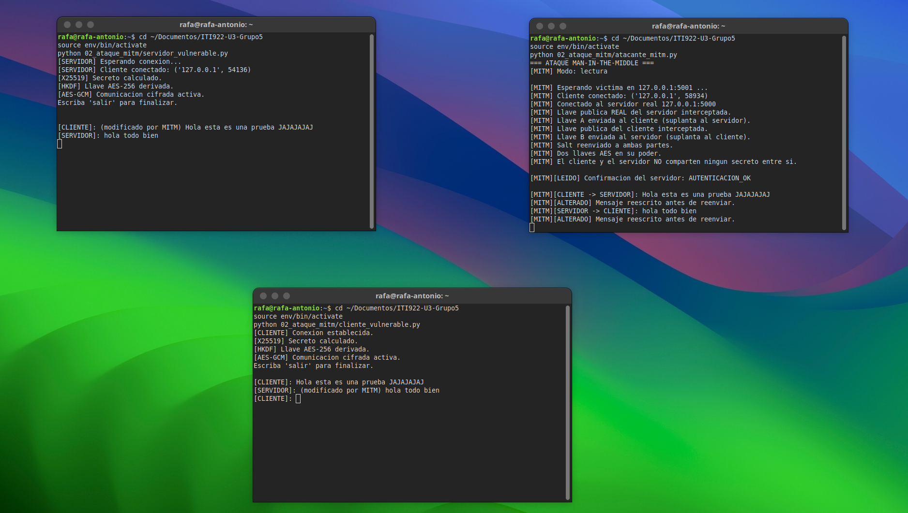
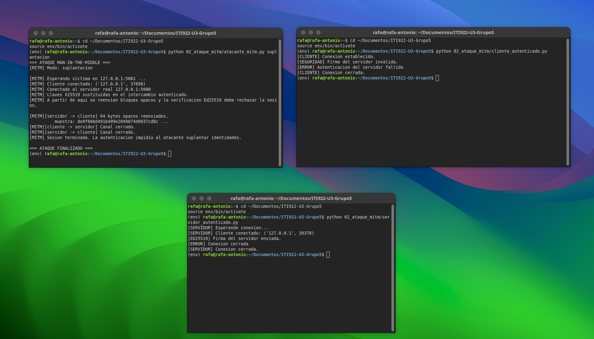
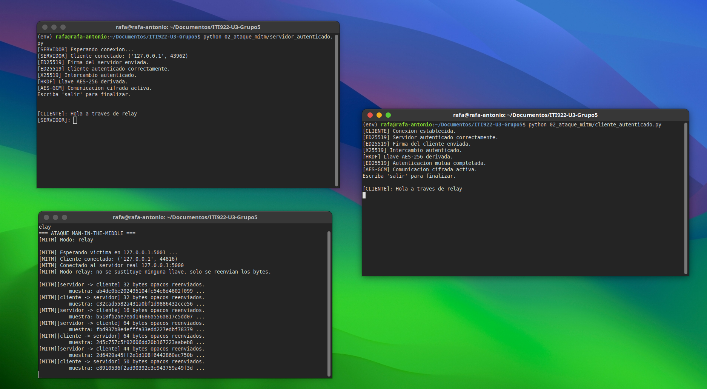
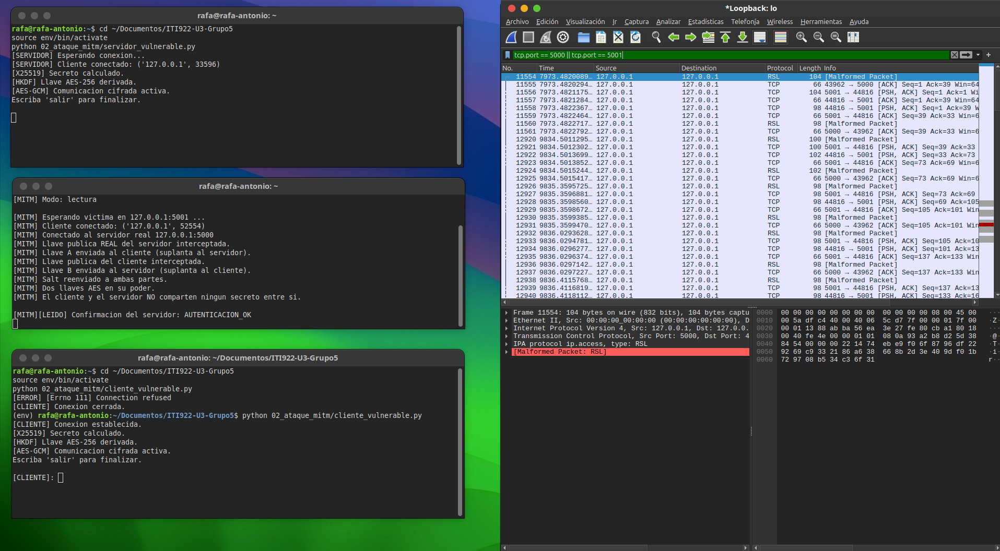

# Guía práctica reproducible — ITI-922, Grupo 5

**Proyecto:** Algoritmos asimétricos y post-cuánticos  
**Práctica 1:** Chat cifrado entre dos terminales  
**Práctica 2:** Demostración del ataque man-in-the-middle (MITM) 
**Práctica 3:** Comparación de algoritmos clásicos y post-cuánticos
**Integrantes:** Eithel, Luis Diego, Rafa y Vanessa  
**Alcance documentado:** Chat TCP local con intercambio de claves X25519, derivación HKDF-SHA-256, cifrado AES-256-GCM y autenticación mutua mediante Ed25519. La comunicación incorpora firmas digitales individuales para cada mensaje, vinculadas a la identidad del emisor, al intercambio criptográfico y a un número de secuencia. Se incluyen pruebas de integridad, verificación de firmas, rechazo de mensajes modificados y protección contra repetición. También se documenta la demostración del ataque MITM y la comparación de RSA-3072, X25519 y ML-KEM-768.

## 1. Objetivo y arquitectura

Construir y comprobar un chat local cliente-servidor en Python que establezca una clave AES compartida sin enviar las claves privadas. Las dos aplicaciones se ejecutan inicialmente dentro de **una misma máquina virtual Ubuntu**, por medio de `127.0.0.1:5000`.

```text
CLIENTE                                     SERVIDOR
  | ----------- conexión TCP -------------> |
  | <-------- pública X25519 servidor ------ |
  | --------- pública X25519 cliente ------> |
  | <------------- salt -------------------- |
  | <--- firma Ed25519 del intercambio ----- |
  | --- firma Ed25519 del intercambio -----> |
  | verificar identidad y transcripción      | verificar identidad y transcripción
  | X25519: secreto compartido               | X25519: secreto compartido
  | HKDF-SHA-256 -> clave AES-256            | HKDF-SHA-256 -> misma clave
  | <--- mensajes firmados Ed25519 y cifrados AES-GCM ---> |
```

**Archivos de la Práctica 1:** `servidor.py`, `cliente.py`, `comunicacion.py`, `criptografia.py`, `autenticacion.py`, `generar_identidades.py`, `prueba_x25519.py`, `prueba_integridad.py`, `prueba_ed25519.py` y `prueba_autenticacion.py` dentro de `01_chat_cifrado/`. Los archivos de identidad privados se generan localmente en `01_chat_cifrado/identidades/` y están excluidos de Git. Las capturas se guardan en `capturas/`.

## 2. Entorno y preparación desde Ubuntu

| Elemento | Configuración comprobada |
|---|---|
| Sistema | Ubuntu 24.04 en VirtualBox |
| Python | 3.12.3 |
| OpenSSL del sistema | 3.0.13 |
| Biblioteca Python | `cryptography` 50.0.2 |
| Comunicación | Socket TCP, `127.0.0.1`, puerto `5000` |

**Paso 1.** Actualizar el índice de paquetes e instalar herramientas:

```bash
sudo apt update
sudo apt install python3-venv python3-pip -y
```

- `sudo` ejecuta con privilegios administrativos.
- `apt update` actualiza el catálogo de paquetes disponibles; no actualiza por sí solo todos los programas.
- `apt install` instala paquetes; `python3-venv` permite entornos virtuales y `python3-pip` instala bibliotecas de Python; `-y` confirma las preguntas de instalación.

**Paso 2.** Obtener el repositorio (en una VM limpia):

```bash
cd ~
git clone https://github.com/eithel03/ITI922-U3-Grupo5.git
cd ITI922-U3-Grupo5
```

- `cd ~` cambia a la carpeta personal.
- `git clone` descarga el repositorio remoto; para repositorios privados se necesita autorización de GitHub.
- El último `cd` entra a la carpeta descargada. **Si ya clonaste el repositorio, omití `git clone`.**

**Paso 3.** Crear el entorno y preparar dependencias:

```bash
python3 -m venv env
source env/bin/activate
python -m pip install -r requirements.txt
python --version
python -m pip show cryptography
```

- `python3 -m venv env`: crea un entorno virtual aislado en `env/`.
- `source env/bin/activate`: activa ese entorno en la terminal actual; debe aparecer `(env)`.
- `python -m pip install -r requirements.txt`: instala las dependencias registradas por el equipo. Para la evidencia se empleó `cryptography==50.0.2`.
- `python --version`: muestra la versión de Python utilizada.
- `python -m pip show cryptography`: muestra versión, ubicación e información de la biblioteca.
- El directorio `env/` debe figurar en `.gitignore`: **no se sube a GitHub**.

**Evidencia 1 — entorno preparado:**


## 3. Prueba inicial de comunicación TCP

Esta comprobación se realizó con una primera versión **sin cifrado**, para aislar problemas de red antes de implementar criptografía. Los archivos actuales `servidor.py` y `cliente.py` corresponden a la versión **cifrada**; para repetir exactamente la etapa inicial debe consultarse el commit `ce18cee` del historial Git, sin reemplazar el código final.

En una primera terminal se ejecutó `python servidor.py`; en una segunda, `python cliente.py` (ambas desde `01_chat_cifrado/`). El servidor esperaba en `127.0.0.1:5000` y ambos intercambiaron texto de prueba.

**Explicación de las llamadas principales:** `socket()` crea la conexión TCP, `bind()` fija IP/puerto del servidor, `listen()` espera solicitudes, `accept()` acepta al cliente, `connect()` conecta desde el cliente, `sendall()` transmite datos y `recv()` recibe bytes. `close()` libera las conexiones. Esa versión inicial era solo diagnóstica; no protegía el contenido.

**Evidencia 2 — prueba inicial de sockets:**


## 4. Intercambio X25519 y derivación HKDF

En `criptografia.py` se implementaron cuatro funciones principales:

| Función | Explicación del código |
|---|---|
| `generar_llaves()` | `X25519PrivateKey.generate()` crea una clave privada; `public_key()` obtiene la pública; `public_bytes(Encoding.Raw, PublicFormat.Raw)` la convierte en bytes para transmitirla. |
| `calcular_secreto()` | `X25519PublicKey.from_public_bytes()` reconstruye la clave pública recibida; `privada.exchange(publica_remota)` calcula el secreto compartido. |
| `generar_salt()` | `os.urandom(16)` obtiene 16 bytes aleatorios para la derivación. Este valor no es secreto y debe coincidir en ambos extremos. |
| `derivar_llave_aes()` | `HKDF(algorithm=SHA256, length=32, salt=salt, info=b"ITI922-Grupo5-Chat")` define la derivación; `.derive(secreto)` obtiene 32 bytes (256 bits). |

**Prueba independiente:** desde la raíz del repositorio, con `env` activo:

```bash
python 01_chat_cifrado/prueba_x25519.py
```

- `python` ejecuta el intérprete del entorno virtual.
- El archivo indicado genera dos pares X25519, calcula el secreto desde cada extremo, compara los secretos, deriva dos llaves AES con el mismo `salt` y comprueba longitud y coincidencia.

**Resultados esperados y observados:** `Secretos iguales: True`, `Llaves AES iguales: True` y `Tamano de la llave AES: 256 bits`.

**Evidencia 3 — X25519 y HKDF:**


## 5. Integración: chat cifrado AES-GCM

**Estructura de la transmisión.** En `comunicacion.py`:

- `enviar_datos()`: `struct.pack("!I", len(datos))` crea un encabezado de 4 bytes (entero sin signo, orden de red) con la longitud; `sendall()` envía encabezado y contenido.
- `recibir_exacto()`: repite `recv()` hasta reunir la cantidad solicitada; detecta si se cierra la conexión.
- `recibir_datos()`: lee 4 bytes, recupera el tamaño con `struct.unpack("!I", encabezado)[0]`, rechaza cargas mayores de 1 MiB y recibe la carga completa.

**Criptografía de mensajes.** En `criptografia.py`:

- `cifrar_mensaje()`: genera un nonce aleatorio de 12 bytes con `os.urandom(12)`, usa `AESGCM(llave).encrypt(nonce, mensaje.encode("utf-8"), None)` y devuelve `nonce + cifrado`; el resultado de `encrypt` incluye la etiqueta de autenticación.
- `descifrar_mensaje()`: separa los primeros 12 bytes como nonce, recupera el resto como texto cifrado y etiqueta, ejecuta `AESGCM(llave).decrypt(...)` y decodifica UTF-8. Si se manipula el contenido, lanza `InvalidTag`.
- **Precaución:** no repetir un nonce con una misma llave AES-GCM. La versión de laboratorio emplea nonces aleatorios; para aplicaciones de producción se requiere un diseño y control explícitos contra reutilización.

**Flujo de servidor y cliente:** `servidor.py` escucha las conexiones TCP y `cliente.py` establece la comunicación. Ambos participantes generan claves X25519, intercambian sus claves públicas y autentican los parámetros del intercambio mediante firmas digitales Ed25519.

Después de verificar las identidades, calculan el secreto compartido y derivan una clave AES-256 mediante HKDF-SHA-256.

Durante la comunicación, cada mensaje se firma individualmente utilizando la identidad Ed25519 del emisor. La firma incluye información vinculada a la sesión, el contenido del mensaje y un número de secuencia.

Posteriormente, el mensaje y su firma se cifran mediante AES-256-GCM antes de enviarse por TCP. El receptor descifra los datos y verifica la firma digital antes de aceptar el mensaje.

La comunicación funciona por turnos: primero envía el cliente y después responde el servidor. El intercambio finaliza al introducir `salir`.

**Preparación previa (una vez por instalación):**

```bash
python 01_chat_cifrado/generar_identidades.py
```

El generador crea identidades Ed25519 locales de servidor y cliente; las claves privadas no se suben al repositorio. Las claves públicas de identidad deben considerarse confiables solo si se han obtenido/verificado por un canal confiable. No regenerar las identidades durante una sesión.

**Terminal 1 — servidor** (desde cualquier directorio):

```bash
cd ~/ITI922-U3-Grupo5
source env/bin/activate
python 01_chat_cifrado/servidor.py
```

**Terminal 2 — cliente** (abrir otra terminal):

```bash
cd ~/ITI922-U3-Grupo5
source env/bin/activate
python 01_chat_cifrado/cliente.py
```

En ambos bloques:
- `cd` sitúa la terminal en la raíz del proyecto.
- `source` activa el entorno Python local.
- `python` inicia el programa indicado. **Iniciar primero el servidor** y dejar su terminal abierta.

**Resultados observados:** el cliente mostró `Servidor autenticado correctamente`, `Intercambio autenticado`, `Llave AES-256 derivada`, `Autenticacion mutua completada` y `Comunicacion cifrada activa`. El servidor confirmó la autenticación del cliente y el intercambio autenticado. Los mensajes de prueba se visualizaron correctamente después de descifrarse. La captura de terminales evidencia el funcionamiento; la captura de red se presenta por separado en la sección 10.

**Evidencia 4 — chat cifrado funcionando:**


## 6. Prueba de integridad AES-GCM

**Ejecutar** desde la raíz del repositorio con `env` activo:

```bash
python 01_chat_cifrado/prueba_integridad.py
```

- `python` ejecuta el script de prueba.
- El script genera una llave AES de 256 bits con `AESGCM.generate_key(bit_length=256)`.
- `cifrar_mensaje()` cifra un mensaje ficticio; `descifrar_mensaje()` confirma que se recupera intacto.
- `bytearray(cifrado)` permite modificar la salida; `manipulado[12] ^= 1` cambia un bit del primer byte cifrado **después de los 12 bytes de nonce**.
- La segunda llamada a `descifrar_mensaje()` debe producir `InvalidTag`; el bloque `except InvalidTag` confirma el rechazo.

**Resultado observado:** el mensaje `Transferir 1000 colones` se descifró correctamente antes de la alteración; después aparecieron `Manipulacion detectada correctamente` y `AES-GCM rechazo el mensaje alterado`.

**Evidencia 5 — rechazo de datos manipulados:**


## 7. Firmas Ed25519: autenticación del intercambio y de los mensajes

El módulo `criptografia.py` incorpora generación de llaves Ed25519, firma y verificación de mensajes binarios. El módulo `generar_identidades.py` crea las identidades locales del cliente y del servidor, y `autenticacion.py` construye y verifica la información firmada del intercambio X25519 (incluido el `salt`). El servidor y el cliente rechazan una autenticación que no se verifique con la clave pública de identidad esperada.

**Prueba de firmas:**

```bash
python 01_chat_cifrado/prueba_ed25519.py
```

**Resultados observados:** firma de 64 bytes; `Firma valida: True`; `Firma de mensaje modificado: False`; `Firma incorrecta aceptada: False`.


**Chat con autenticación mutua:**


### Verificación de firmas individuales en el chat

El módulo `autenticacion.py` incorpora las funciones `firmar_chat()` y `verificar_chat()`, utilizadas para proteger individualmente los mensajes intercambiados entre cliente y servidor.

La función `firmar_chat()` genera una firma Ed25519 utilizando la clave privada del emisor y construye un mensaje estructurado en formato JSON que contiene el texto original, la firma digital, la versión del formato y el número de secuencia.

Por su parte, `verificar_chat()` utiliza la clave pública Ed25519 correspondiente para comprobar la autenticidad del mensaje recibido. También verifica que el número de secuencia coincida con el esperado.

**Pruebas realizadas:**

| Prueba | Resultado |
|---|---|
| Verificación de firma legítima | Firma aceptada correctamente. |
| Modificación del contenido firmado | Mensaje rechazado. |
| Repetición de un mensaje anterior | Mensaje rechazado por número de secuencia incorrecto. |
| Verificación con identidad incorrecta | Firma rechazada. |

**Resultado de las pruebas:**

```text
[OK] Firma Ed25519 valida
[OK] Mensaje alterado rechazado
[OK] Mensaje repetido rechazado
[OK] Identidad incorrecta rechazada

Todas las pruebas de firmas finalizaron.
```

Adicionalmente, se ejecutó el chat completo entre cliente y servidor. Se intercambiaron tres mensajes consecutivos y ambos participantes verificaron correctamente las firmas recibidas.

Durante la ejecución, el servidor mostró:

```text
[ED25519] Firma del mensaje del cliente valida.
```

Mientras que el cliente confirmó:

```text
[ED25519] Firma del mensaje del servidor valida.
```

Estas pruebas comprobaron el funcionamiento de las firmas digitales individuales en ambos sentidos de la comunicación.

## 8. Rechazo de identidad falsa y manipulación

Ejecutar:

```bash
python 01_chat_cifrado/prueba_autenticacion.py
```

**Resultados observados:**

```text
=== PRUEBA DE AUTENTICACION ED25519 ===
[1] Firma legitima aceptada: True
[2] Identidad falsa aceptada: False
[3] Intercambio modificado aceptado: False
[4] Salt modificado aceptado: False
[OK] Todas las pruebas fueron exitosas.
[SEGURIDAD] Identidades falsas rechazadas.
[SEGURIDAD] Manipulaciones detectadas.
=== PRUEBA FINALIZADA ===
```

La prueba valida el rechazo criptográfico de firmas de una identidad distinta y de cambios en los parámetros firmados. No simula por sí sola un atacante intermediario sobre una red real.


## 9. Captura de tráfico con Wireshark

Se utilizó Wireshark 4.2.2 en Ubuntu, interfaz `lo` (loopback), porque la comunicación ocurre entre `127.0.0.1` y `127.0.0.1` mediante TCP puerto `5000`. Para visualizar segmentos con carga útil se aplicó:

```text
tcp.port == 5000 && tcp.len > 0
```

Wireshark inicialmente interpretó erróneamente el puerto 5000 como GSM over IP/IPA/RSL. Se cambió **Analizar → Decodificar como... → Data** para mostrar la carga útil sin una decodificación incorrecta. Esta clasificación automática no implicaba un fallo del chat.

Se envió desde el cliente el mensaje ASCII `PRUEBA_AES_256_GRUPO5` (21 bytes). El filtro:

```text
tcp.port == 5000 && tcp.len == 53
```

permitió identificar el paquete 50, con `Data (53 bytes)`, en el sentido cliente → servidor. El tamaño coincide con el formato implementado:

| Campo | Bytes |
|---|---:|
| Encabezado de longitud de aplicación | 4 |
| Nonce AES-GCM | 12 |
| Texto cifrado del mensaje de 21 bytes | 21 |
| Etiqueta de autenticación GCM | 16 |
| **Total** | **53** |

**Nota:** esta captura corresponde a la implementación inicial del cifrado AES-256-GCM. En la versión actual, cada mensaje incorpora una firma digital Ed25519 y otros campos de control dentro de un sobre JSON cifrado. Por lo tanto, el tamaño de los mensajes transmitidos es mayor que los 53 bytes observados en esta evidencia inicial.

El mensaje en claro no aparece en el contenido hexadecimal capturado. La captura demuestra el formato y la ausencia del texto legible en ese envío; la seguridad criptográfica se complementa con la revisión del código y la prueba `prueba_integridad.py`.


**Archivo de captura:** [`capturas/chat_cifrado_grupo5.pcapng`](capturas/chat_cifrado_grupo5.pcapng).

## 10. Problemas comunes y soluciones

| Problema | Posible causa | Solución |
|---|---|---|
| `Connection refused` | El servidor no estaba iniciado. | Ejecutar primero `servidor.py`. |
| `ConnectionError: Conexion cerrada` | El cliente cerró con `Ctrl+C` mientras el servidor esperaba. | Terminar normalmente escribiendo `salir`. |
| `Address already in use` | Puerto 5000 ocupado. | Cerrar la instancia anterior del servidor. |
| `ModuleNotFoundError: cryptography` | Entorno virtual inactivo o dependencia ausente. | Activar `env` y ejecutar `python -m pip install -r requirements.txt`. |
| Error al activar `env` | Directorio de trabajo incorrecto. | Volver a la raíz del repositorio. |
| `InvalidTag` | Mensaje cifrado, nonce, etiqueta o clave no coinciden. | Rechazar el mensaje e investigar la alteración. |
| `RSL [Malformed Packet]` / `IPA` en Wireshark | Decodificación automática incorrecta del puerto 5000. | Utilizar **Decodificar como... → Data**. |
| Wireshark no muestra interfaces | Permisos de captura insuficientes. | Configurar `wireshark-common`, grupo `wireshark` y reiniciar sesión. |

## 11. Alcance y consideraciones de seguridad

La Práctica 1 se comprobó en una máquina virtual Ubuntu mediante una conexión TCP local y comunicación por turnos. El sistema utiliza X25519 para establecer un secreto compartido, HKDF-SHA-256 para derivar la clave AES y AES-256-GCM para cifrar y proteger la integridad de los mensajes.

Ed25519 permite autenticar el intercambio inicial y firmar individualmente cada mensaje transmitido. Las pruebas realizadas confirmaron la verificación de firmas legítimas y el rechazo de mensajes modificados, identidades incorrectas y números de secuencia inesperados.

Se utilizan nonces aleatorios de 12 bytes para AES-GCM y las identidades Ed25519 se almacenan localmente. La verificación de identidad requiere que las claves públicas correspondientes sean previamente confiables. 

## 12. Registro de evidencias de la Práctica 1

| Archivo | Evidencia |
|---|---|
| `01_entorno_python.png` | Entorno Python y biblioteca criptográfica. |
| `02_comunicacion_sockets.png` | Prueba inicial de comunicación TCP. |
| `03_intercambio_x25519_hkdf.png` | Secreto compartido y clave AES coincidentes. |
| `04_chat_cifrado_aes_gcm.png` | Comunicación cifrada en terminales. |
| `05_integridad_aes_gcm.png` | Rechazo de alteración mediante AES-GCM. |
| `06_firmas_ed25519.png` | Verificación de firmas legítimas y falsas. |
| `07_chat_autenticado_ed25519.png` | Autenticación mutua durante el chat. |
| `08_rechazo_identidad_falsa.png` | Rechazo de identidad falsa y parámetros modificados. |
| `09_trafico_tcp_wireshark.png` | Captura TCP en la interfaz loopback. |
| `10_datos_cifrados_aes_gcm.png` | Carga útil de 53 bytes asociada al mensaje cifrado. |
| `chat_cifrado_grupo5.pcapng` | Registro de paquetes para inspección en Wireshark. |

**Reproducción:** preparar el entorno e identidades, iniciar servidor y cliente, ejecutar las cuatro pruebas y capturar en `lo` el puerto TCP 5000. Los comandos y resultados se documentan en las secciones anteriores.

---

# Práctica 2 — Demostración del ataque man-in-the-middle (MITM)

**Objetivo:** demostrar que un intercambio Diffie-Hellman (X25519) sin autenticación permite que un tercer programa se coloque entre el cliente y el servidor, lea y altere los mensajes; y que las firmas Ed25519 sobre la transcripción del intercambio impiden ese ataque.

## 1. Arquitectura del ataque

El atacante (`atacante_mitm.py`) escucha en el puerto **5001** y se conecta al servidor real en el puerto **5000**. El cliente vulnerable se conecta al puerto 5001 sin saber que está hablando con un intermediario.

```text
CLIENTE                 ATACANTE MITM              SERVIDOR
  |                          |                         |
  | -- publica X25519 ------>|<-- publica X25519 ------|
  |    (recibe llave A)      |    (recibe llave B)     |
  |                          |                         |
  |  secreto cliente-A       |       secreto B-servidor|
  |  llave AES C             |       llave AES S       |
  |                          |                         |
  | <--- mensajes AES-GCM -->|-- descifra, lee,altera ->|
```

Sin firmas, el atacante termina **dos intercambios X25519 independientes**: uno con el cliente (llave A) y otro con el servidor (llave B). Deriva dos llaves AES distintas, descifra cada mensaje por un lado y lo vuelve a cifrar por el otro. Con firmas Ed25519, la transcripción firmada deja de coincidir cuando el atacante sustituye una llave y la verificación falla.

**Archivos de la Práctica 2:** `servidor_vulnerable.py`, `cliente_vulnerable.py`, `servidor_autenticado.py`, `cliente_autenticado.py`, `atacante_mitm.py` y `prueba_mitm.py` dentro de `02_ataque_mitm/`. Los módulos criptográficos (`criptografia.py`, `comunicacion.py`, `autenticacion.py`) se reutilizan desde `01_chat_cifrado/` mediante una inserción de ruta en `sys.path`, por lo que no se duplica el código de la Práctica 1.

## 2. Requisitos previos

El entorno virtual `env/` y las identidades Ed25519 de la Práctica 1 deben existir:

```bash
cd ~/ITI922-U3-Grupo5
source env/bin/activate
python 01_chat_cifrado/generar_identidades.py   # solo la primera vez
```

## 3. Prueba automática del ataque (sin redes)

```bash
python 02_ataque_mitm/prueba_mitm.py
```

El script no usa sockets: simula las matemáticas del ataque en memoria y verifica tres hechos:

1. Sin firmas, el cliente y el servidor **no** comparten secreto entre sí; en cambio el atacante comparte un secreto con cada uno.
2. El atacante **descifra** el mensaje del cliente y lo reenvía al servidor.
3. Con firmas, ni la firma real sobre una llave sustituida ni la firma del atacante son aceptadas.

**Salida observada:**

```text
=== PRUEBA DE ATAQUE MITM ===

--- Parte 1: protocolo SIN firmas ---
[1] Secreto cliente == secreto servidor: False
[2] El atacante comparte secreto con el servidor: True
[3] El atacante comparte secreto con el cliente: True
[4] Mensaje que lee el atacante: Transferir 1000 colones
[5] El servidor recibe el mensaje reenviado: Transferir 1000 colones
[OK] Sin firmas, el atacante leyo y reenvio el mensaje completo.

--- Parte 2: protocolo CON firmas ---
[6] Firma real aceptada con llave sustituida: False
[7] Firma del atacante aceptada: False
[8] Firma legitima en transcripcion correcta: True

[OK] Todas las pruebas MITM fueron exitosas.
[SEGURIDAD] Sin firmas el ataque funciona; con firmas Ed25519 es bloqueado.

=== PRUEBA FINALIZADA ===
```

**Evidencia 11 — prueba automática MITM:**


## 4. Escenario A: ataque exitoso sin firmas

Se necesitan **tres terminales** con el entorno activo. El orden de inicio es: servidor, atacante y finalmente cliente.

**Terminal 1 — servidor vulnerable:**

```bash
cd ~/ITI922-U3-Grupo5
source env/bin/activate
python 02_ataque_mitm/servidor_vulnerable.py
```

- Escucha en `127.0.0.1:5000` con X25519 + HKDF + AES-GCM, pero **sin** firmas Ed25519.

**Terminal 2 — atacante MITM:**

```bash
cd ~/ITI922-U3-Grupo5
source env/bin/activate
python 02_ataque_mitm/atacante_mitm.py
```

- Sin argumentos, ejecuta el modo `lectura`: escucha en el puerto 5001, se conecta al servidor y prepara dos llaves AES propias.

**Terminal 3 — cliente vulnerable:**

```bash
cd ~/ITI922-U3-Grupo5
source env/bin/activate
python 02_ataque_mitm/cliente_vulnerable.py
```

- Se conecta al puerto 5001 (el atacante), cree que habla con el servidor.

Escribir un mensaje de prueba en el cliente (por ejemplo `hola MITM, este mensaje es secreto`), responder en el servidor y cerrar con `salir`.

**Salida del atacante (la parte central de la demo):**

```text
[MITM] Llave publica REAL del servidor interceptada.
[MITM] Llave A enviada al cliente (suplanta al servidor).
[MITM] Llave publica del cliente interceptada.
[MITM] Llave B enviada al servidor (suplanta al cliente).
[MITM] Dos llaves AES en su poder.
[MITM] El cliente y el servidor NO comparten ningun secreto entre si.

[MITM][LEIDO] Confirmacion del servidor: AUTENTICACION_OK

[MITM][CLIENTE -> SERVIDOR]: hola MITM, este mensaje es secreto
[MITM][ALTERADO] Mensaje reescrito antes de reenviar.
[MITM][SERVIDOR -> CLIENTE]: todo bien, mensaje recibido
[MITM][ALTERADO] Mensaje reescrito antes de reenviar.
```

El cliente y el servidor reciben los mensajes con el prefijo `(modificado por MITM) `, lo que demuestra que el atacante no solo leyó la conversación sino que también la alteró. La constante `MODIFICAR_MENSAJES` de `atacante_mitm.py` controla ese comportamiento.

**Evidencia 12 — escenario A en las tres terminales:**



## 5. Escenario B: la suplantación es bloqueada con firmas

Mismas tres terminales, pero con el protocolo autenticado y el modo `suplantacion` del atacante.

**Terminal 1 — servidor autenticado:**

```bash
python 02_ataque_mitm/servidor_autenticado.py
```

**Terminal 2 — atacante (modo suplantación):**

```bash
python 02_ataque_mitm/atacante_mitm.py suplantacion
```

- Sustituye las llaves X25519 igual que en el Escenario A y después reenvía los bloques restantes sin poder descifrarlos.

**Terminal 3 — cliente autenticado:**

```bash
python 02_ataque_mitm/cliente_autenticado.py
```

**Resultado observado:** el cliente rechaza la sesión antes de cualquier mensaje.

```text
[CLIENTE] Conexion establecida.
[SEGURIDAD] Firma del servidor invalida.
[ERROR] Autenticacion del servidor fallida
[CLIENTE] Conexion cerrada.
```

El atacante solo observa la firma de 64 bytes que no puede validar ni reemplazar:

```text
[MITM] Llaves X25519 sustituidas en el intercambio autenticado.
[MITM][servidor -> cliente] 64 bytes opacos reenviados.
          muestra: edca5ab1510336887330c70658b5de56 ...
[MITM][cliente -> servidor] Canal cerrado.
[MITM] Sesion terminada. La autenticacion impidio al atacante suplantar identidades.
```

La verificación falla porque la transcripción firmada por el servidor contiene su llave X25519 auténtica, mientras que el cliente intenta verificar contra la llave que el atacante le presentó. La firma Ed25519 cubre exactamente esos parámetros: contexto del protocolo + ambas llaves públicas + salt.

**Evidencia 13 — escenario B, rechazo de la suplantación:**



## 6. Escenario C: reenvío opaco con firmas (relay)

```bash
# Terminal 1
python 02_ataque_mitm/servidor_autenticado.py
# Terminal 2
python 02_ataque_mitm/atacante_mitm.py relay
# Terminal 3
python 02_ataque_mitm/cliente_autenticado.py
```

En este modo el atacante **no** sustituye llaves: solo reenvía los bytes. La sesión autenticada se completa con éxito a través del atacante, pero este solo ve tramas opacas:

```text
[MITM][servidor -> cliente] 64 bytes opacos reenviados.
          muestra: 4b4297196619f9c88929f5bf24c9ccd2 ...
[MITM][cliente -> servidor] 51 bytes opacos reenviados.
          muestra: 27a8167fc17589d4eee44eb7189bd5ee ...
```

Con firmas no es necesario bloquear el reenvío: aunque el atacante esté en el camino, el contenido permanece cifrado y la autenticación mutua garantiza con quién se habla.

**Evidencia 14 — escenario C, relay opaco:**



## 7. Captura de tráfico del ataque

Durante el Escenario A se capturó la interfaz `lo` con el filtro:

```text
tcp port 5000 or tcp port 5001
```

La captura contiene 40 paquetes entre cliente-atacante (puerto 5001) y atacante-servidor (puerto 5000). La búsqueda del mensaje de prueba `PRUEBA_MITM_GRUPO5` en el archivo **no** encuentra texto en claro: en la red solo circulan las tramas AES-GCM. Quien ve el contenido en la terminal del atacante es el atacante, porque él termina el intercambio criptográfico por ambos lados, no porque el tráfico viaje en claro.

**Archivo de captura:** [`capturas/ataque_mitm_grupo5.pcapng`](capturas/ataque_mitm_grupo5.pcapng).

**Evidencia 15 — Wireshark con tráfico de los puertos 5000 y 5001:**



## 8. Problemas comunes

| Problema | Posible causa | Solución |
|---|---|---|
| `Connection refused` en el cliente | El atacante no está escuchando en 5001. | Iniciar primero `atacante_mitm.py`. |
| `Connection refused` en el atacante | El servidor no está en el puerto 5000. | Iniciar primero `servidor_vulnerable.py` o `servidor_autenticado.py`. |
| El servidor muestra `[ERROR] Conexion cerrada` en el Escenario B | Es el resultado esperado: el cliente rechazó la firma y cerró. | Verificar que el cliente muestre `[SEGURIDAD] Firma del servidor invalida`. |
| `FileNotFoundError` de identidades | No se generaron las identidades de la Práctica 1. | Ejecutar `python 01_chat_cifrado/generar_identidades.py`. |
| Los puertos 5000/5001 siguen ocupados | Una sesión anterior no cerró. | Cerrar las terminales y revisar con `ss -tlnp \| grep 500`. |
| El cliente no conecta al atacante | Se ejecutó `cliente_vulnerable.py` sin el atacante, o se ejecutó `01_chat_cifrado/cliente.py` (usa el puerto 5000). | Usar los clientes de `02_ataque_mitm/`. |

## 9. Alcance y consideraciones de seguridad

La demostración ocurre en loopback (`127.0.0.1`) con tres procesos locales; el "atacante" necesita participación activa en el camino de conexión, como un proxy o una máquina intermedia real. El ataque MITM demuestra por qué el intercambio de claves debe ir acompañado de autenticación: firmas digitales con una identidad de confianza previa o certificados. En la Práctica 1 y en el Escenario B la confianza en la clave pública de identidad depende de su distribución previa por un medio confiable; en un entorno real ese rol lo cumplen los certificados y una autoridad de certificación (como ocurre en TLS).

## 10. Registro de evidencias de la Práctica 2

| Archivo | Evidencia |
|---|---|
| `11_prueba_mitm_automatica.png` | Prueba automática: ataque funciona sin firmas y falla con firmas. |
| `12_mitm_escenario_a_ataque_exitoso.png` | Tres terminales: atacante lee y altera la conversación. |
| `13_mitm_escenario_b_bloqueado.png` | Suplantación rechazada por la firma Ed25519. |
| `14_mitm_escenario_c_relay.png` | Relay opaco: sesión autenticada ilegible. |
| `15_mitm_wireshark_puertos_5000_5001.png` | Wireshark mostrando los dos puertos del ataque. |
| `ataque_mitm_grupo5.pcapng` | Registro de paquetes del Escenario A. |

**Reproducción:** generar identidades si no existen; ejecutar `prueba_mitm.py`; luego los tres escenarios con servidor, atacante y cliente en tres terminales; capturar en `lo` los puertos 5000 y 5001 durante el Escenario A.


## Práctica 3: Comparación de algoritmos clásicos y post-cuánticos

### Objetivo

Comparar RSA-3072, X25519 y ML-KEM-768 mediante el tamaño de las claves públicas, los datos intercambiados y los tiempos de operación. También se utilizó Wireshark para observar el tráfico TCP generado por cada algoritmo.

### Procedimiento

1. Se ejecutó el programa `03_comparacion/comparar_algoritmos.py`, realizando 10 mediciones por algoritmo.
2. Se guardaron los resultados en un archivo CSV, una tabla Markdown y dos gráficos SVG.
3. Se creó una demostración de intercambio mediante sockets TCP en la dirección local `127.0.0.1`.
4. Se capturó el tráfico de los puertos 5101, 5102 y 5103 con TShark y se revisó la captura en Wireshark.
5. Se identificaron los paquetes que contenían los mensajes criptográficos y se compararon sus longitudes.

### Comandos de ejecución

Desde la raíz del repositorio, activar el entorno virtual:

```bash
source env/bin/activate
```

**Ejecutar la comparación:**

```bash
python 03_comparacion/comparar_algoritmos.py
```

Este comando realiza diez mediciones por algoritmo y genera los archivos de resultados en `03_comparacion/`.

**Capturar los intercambios TCP:**

Abrir una primera terminal y ejecutar:

```bash
sudo tshark -i lo -f "tcp portrange 5101-5103" -w /tmp/comparacion_grupo5.pcapng
```

Abrir una segunda terminal, activar el entorno virtual y ejecutar:

```bash
python 03_comparacion/trafico_comparacion.py
```

El programa realiza los intercambios TCP mediante los puertos 5101 para RSA-3072, 5102 para X25519 y 5103 para ML-KEM-768.

Al finalizar, detener TShark mediante `Ctrl + C`.

Para abrir la captura en Wireshark:

```bash
sudo chown "$USER":"$USER" /tmp/comparacion_grupo5.pcapng
wireshark /tmp/comparacion_grupo5.pcapng
```

Los paquetes de cada algoritmo pueden identificarse mediante los siguientes filtros:

| Algoritmo | Filtro |
|---|---|
| RSA-3072 | `tcp.port == 5101 && tcp.len > 0` |
| X25519 | `tcp.port == 5102 && tcp.len > 0` |
| ML-KEM-768 | `tcp.port == 5103 && tcp.len > 0` |

Los resultados permiten comparar los tamaños de las claves públicas y los datos intercambiados por cada mecanismo.

### Resultados

| Algoritmo | Clave pública | Datos criptográficos intercambiados | Generación de claves promedio |
|---|---:|---:|---:|
| RSA-3072 | 422 bytes | 806 bytes | 646.4936 ms |
| X25519 | 32 bytes | 64 bytes | 19.7331 ms |
| ML-KEM-768 | 1184 bytes | 2272 bytes | 0.5421 ms |

Los tamaños de los mensajes fueron comprobados mediante las longitudes TCP observadas en Wireshark. RSA-3072 transmitió una clave pública de 422 bytes y un mensaje cifrado de 384 bytes. X25519 intercambió dos claves públicas de 32 bytes cada una. ML-KEM-768 transmitió una clave pública de 1184 bytes y un texto cifrado de encapsulación de 1088 bytes.

### Análisis

X25519 presentó el menor tamaño de intercambio, con 64 bytes. ML-KEM-768 intercambió más datos, pero tuvo el menor tiempo promedio de generación de claves en las mediciones realizadas. RSA-3072 presentó el mayor tiempo promedio de generación de claves en este equipo.

Los tiempos dependen del hardware y de las condiciones de ejecución. Las operaciones medidas tampoco son idénticas entre algoritmos, por lo que los tiempos deben interpretarse teniendo en cuenta el tipo de operación realizada.

Los tamaños de intercambio corresponden a los mensajes criptográficos de esta demostración. No incluyen las cabeceras de red ni representan el tamaño de una sesión TLS completa.

### Evidencias

Las evidencias de Wireshark se guardan en la carpeta `capturas`:

- `comparacion_rsa.png`
- `comparacion_x25519.png`
- `comparacion_mlkem.png`
- `comparacion.pcapng`

Los resultados numéricos y los gráficos generados se encuentran en `03_comparacion`.

### Archivos de la práctica

- `03_comparacion/comparar_algoritmos.py`: medición de los algoritmos.
- `03_comparacion/trafico_comparacion.py`: demostración de intercambio TCP.
- `03_comparacion/resultados.csv`: resultados numéricos.
- `03_comparacion/resultados.md`: tabla y análisis.
- `03_comparacion/grafico_tamanos.svg`: gráfico de tamaños.
- `03_comparacion/grafico_tiempos.svg`: gráfico de tiempos.


