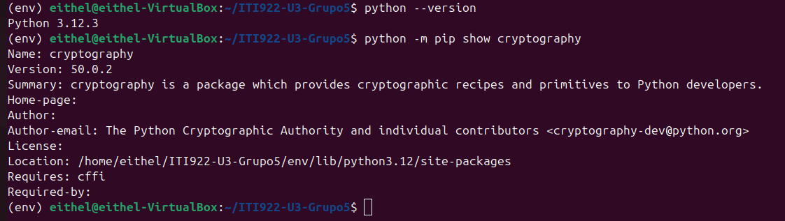
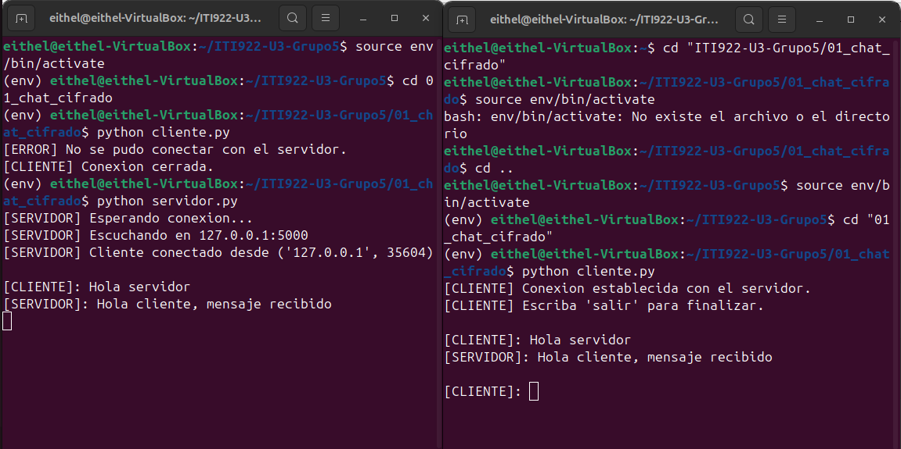
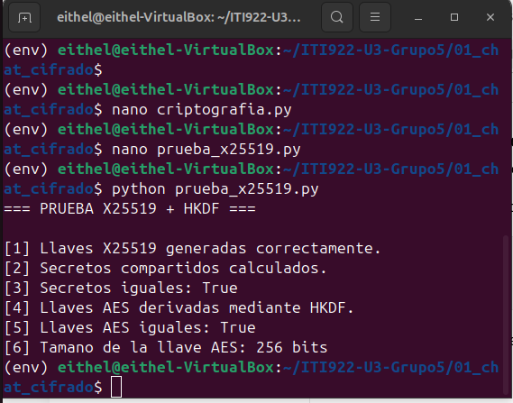
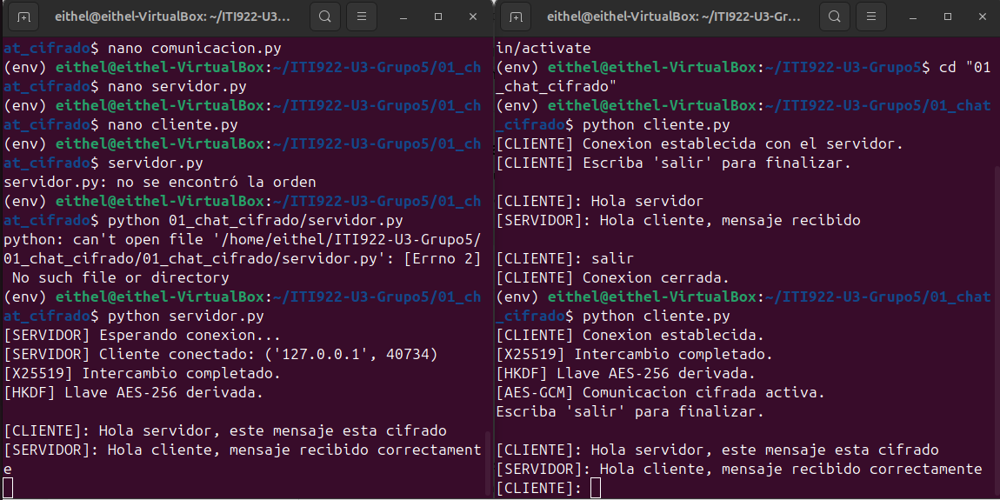
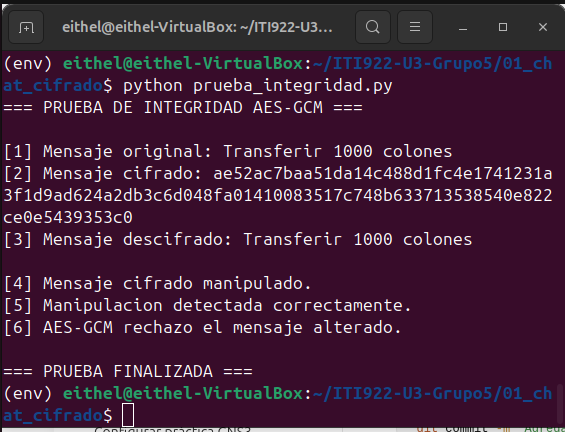
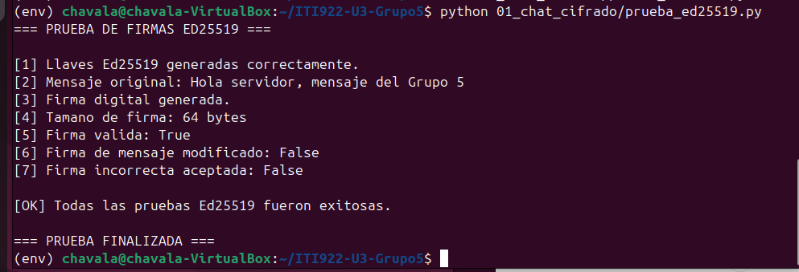
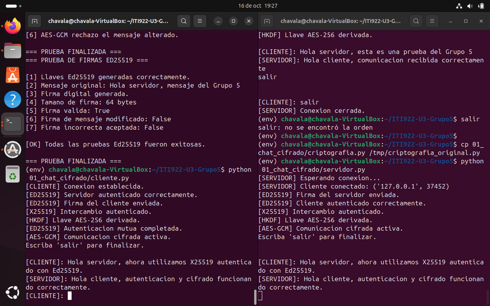
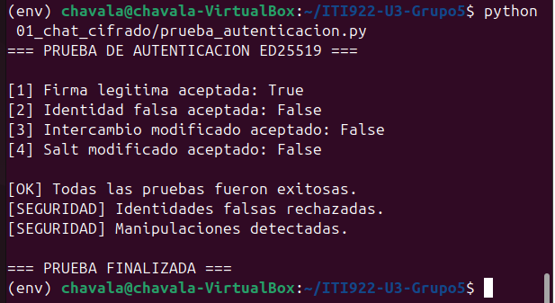
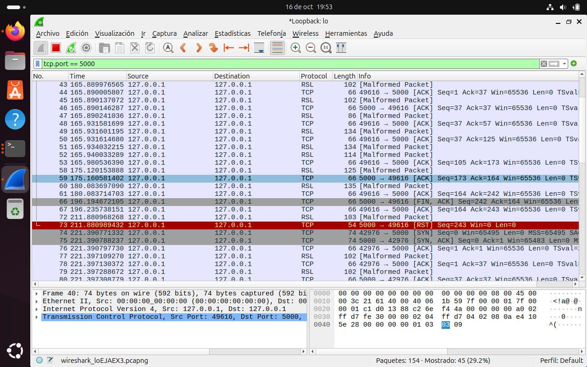
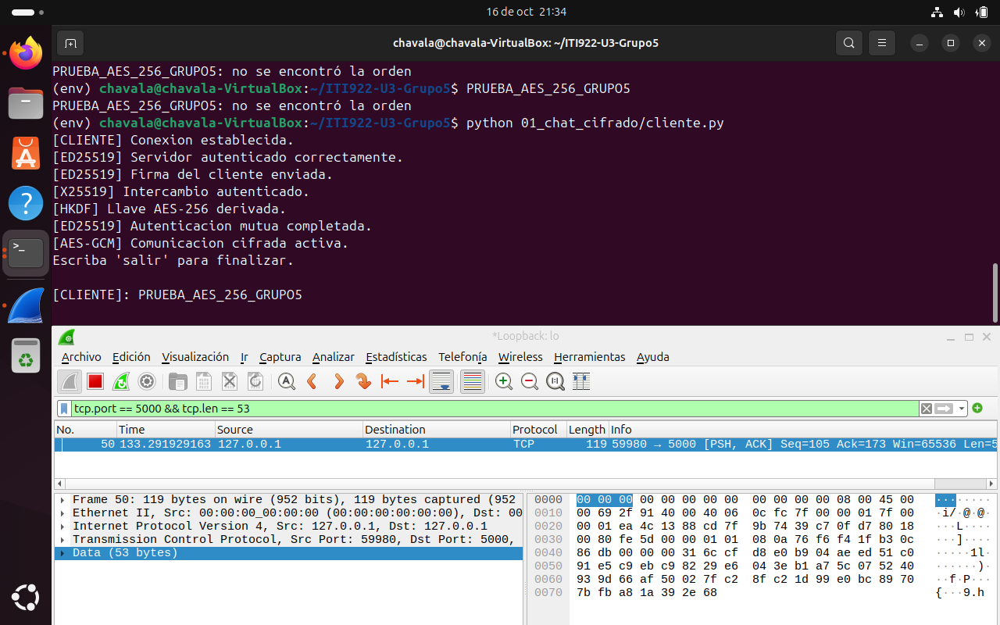

# Guía práctica reproducible — ITI-922, Grupo 5

**Proyecto:** Algoritmos asimétricos y post-cuánticos  
**Práctica 1:** Chat cifrado entre dos terminales  
**Integrantes:** Eithel, Luis Diego, Rafa y Vanessa  
**Alcance documentado:** Chat TCP local con X25519, HKDF-SHA-256, AES-256-GCM y autenticación mutua Ed25519 del intercambio; pruebas de firmas, integridad, rechazo de identidad falsa y captura Wireshark. La demostración MITM pertenece a la Práctica 2.

## 1. Objetivo y arquitectura

Construir y comprobar un chat local cliente-servidor en Python que establezca una clave AES compartida sin enviar las claves privadas. Las dos aplicaciones se ejecutan inicialmente dentro de **una misma máquina virtual Ubuntu**, por medio de `127.0.0.1:5000`.

```text
CLIENTE                                     SERVIDOR
  | ----------- conexión TCP -------------> |
  | <-------- pública X25519 servidor ------ |
  | --------- pública X25519 cliente ------> |
  | <------------- salt -------------------- |
  | <--- firma Ed25519 del intercambio ----- |
  | --- firma Ed25519 del intercambio -----> |
  | verificar identidad y transcripción      | verificar identidad y transcripción
  | X25519: secreto compartido               | X25519: secreto compartido
  | HKDF-SHA-256 -> clave AES-256            | HKDF-SHA-256 -> misma clave
  | <-------- mensajes AES-GCM ------------> |
```

**Archivos de la Práctica 1:** `servidor.py`, `cliente.py`, `comunicacion.py`, `criptografia.py`, `autenticacion.py`, `generar_identidades.py`, `prueba_x25519.py`, `prueba_integridad.py`, `prueba_ed25519.py` y `prueba_autenticacion.py` dentro de `01_chat_cifrado/`. Los archivos de identidad privados se generan localmente en `01_chat_cifrado/identidades/` y están excluidos de Git. Las capturas se guardan en `capturas/`.

## 2. Entorno y preparación desde Ubuntu

| Elemento | Configuración comprobada |
|---|---|
| Sistema | Ubuntu 24.04 en VirtualBox |
| Python | 3.12.3 |
| OpenSSL del sistema | 3.0.13 |
| Biblioteca Python | `cryptography` 50.0.2 |
| Comunicación | Socket TCP, `127.0.0.1`, puerto `5000` |

**Paso 1.** Actualizar el índice de paquetes e instalar herramientas:

```bash
sudo apt update
sudo apt install python3-venv python3-pip -y
```

- `sudo` ejecuta con privilegios administrativos.
- `apt update` actualiza el catálogo de paquetes disponibles; no actualiza por sí solo todos los programas.
- `apt install` instala paquetes; `python3-venv` permite entornos virtuales y `python3-pip` instala bibliotecas de Python; `-y` confirma las preguntas de instalación.

**Paso 2.** Obtener el repositorio (en una VM limpia):

```bash
cd ~
git clone https://github.com/eithel03/ITI922-U3-Grupo5.git
cd ITI922-U3-Grupo5
```

- `cd ~` cambia a la carpeta personal.
- `git clone` descarga el repositorio remoto; para repositorios privados se necesita autorización de GitHub.
- El último `cd` entra a la carpeta descargada. **Si ya clonaste el repositorio, omití `git clone`.**

**Paso 3.** Crear el entorno y preparar dependencias:

```bash
python3 -m venv env
source env/bin/activate
python -m pip install -r requirements.txt
python --version
python -m pip show cryptography
```

- `python3 -m venv env`: crea un entorno virtual aislado en `env/`.
- `source env/bin/activate`: activa ese entorno en la terminal actual; debe aparecer `(env)`.
- `python -m pip install -r requirements.txt`: instala las dependencias registradas por el equipo. Para la evidencia se empleó `cryptography==50.0.2`.
- `python --version`: muestra la versión de Python utilizada.
- `python -m pip show cryptography`: muestra versión, ubicación e información de la biblioteca.
- El directorio `env/` debe figurar en `.gitignore`: **no se sube a GitHub**.

**Evidencia 1 — entorno preparado:**



## 3. Prueba inicial de comunicación TCP

Esta comprobación se realizó con una primera versión **sin cifrado**, para aislar problemas de red antes de implementar criptografía. Los archivos actuales `servidor.py` y `cliente.py` corresponden a la versión **cifrada**; para repetir exactamente la etapa inicial debe consultarse el commit `ce18cee` del historial Git, sin reemplazar el código final.

En una primera terminal se ejecutó `python servidor.py`; en una segunda, `python cliente.py` (ambas desde `01_chat_cifrado/`). El servidor esperaba en `127.0.0.1:5000` y ambos intercambiaron texto de prueba.

**Explicación de las llamadas principales:** `socket()` crea la conexión TCP, `bind()` fija IP/puerto del servidor, `listen()` espera solicitudes, `accept()` acepta al cliente, `connect()` conecta desde el cliente, `sendall()` transmite datos y `recv()` recibe bytes. `close()` libera las conexiones. Esa versión inicial era solo diagnóstica; no protegía el contenido.

**Evidencia 2 — prueba inicial de sockets:**



## 4. Intercambio X25519 y derivación HKDF

En `criptografia.py` se implementaron cuatro funciones principales:

| Función | Explicación del código |
|---|---|
| `generar_llaves()` | `X25519PrivateKey.generate()` crea una clave privada; `public_key()` obtiene la pública; `public_bytes(Encoding.Raw, PublicFormat.Raw)` la convierte en bytes para transmitirla. |
| `calcular_secreto()` | `X25519PublicKey.from_public_bytes()` reconstruye la clave pública recibida; `privada.exchange(publica_remota)` calcula el secreto compartido. |
| `generar_salt()` | `os.urandom(16)` obtiene 16 bytes aleatorios para la derivación. Este valor no es secreto y debe coincidir en ambos extremos. |
| `derivar_llave_aes()` | `HKDF(algorithm=SHA256, length=32, salt=salt, info=b"ITI922-Grupo5-Chat")` define la derivación; `.derive(secreto)` obtiene 32 bytes (256 bits). |

**Prueba independiente:** desde la raíz del repositorio, con `env` activo:

```bash
python 01_chat_cifrado/prueba_x25519.py
```

- `python` ejecuta el intérprete del entorno virtual.
- El archivo indicado genera dos pares X25519, calcula el secreto desde cada extremo, compara los secretos, deriva dos llaves AES con el mismo `salt` y comprueba longitud y coincidencia.

**Resultados esperados y observados:** `Secretos iguales: True`, `Llaves AES iguales: True` y `Tamano de la llave AES: 256 bits`.

**Evidencia 3 — X25519 y HKDF:**



## 5. Integración: chat cifrado AES-GCM

**Estructura de la transmisión.** En `comunicacion.py`:

- `enviar_datos()`: `struct.pack("!I", len(datos))` crea un encabezado de 4 bytes (entero sin signo, orden de red) con la longitud; `sendall()` envía encabezado y contenido.
- `recibir_exacto()`: repite `recv()` hasta reunir la cantidad solicitada; detecta si se cierra la conexión.
- `recibir_datos()`: lee 4 bytes, recupera el tamaño con `struct.unpack("!I", encabezado)[0]`, rechaza cargas mayores de 1 MiB y recibe la carga completa.

**Criptografía de mensajes.** En `criptografia.py`:

- `cifrar_mensaje()`: genera un nonce aleatorio de 12 bytes con `os.urandom(12)`, usa `AESGCM(llave).encrypt(nonce, mensaje.encode("utf-8"), None)` y devuelve `nonce + cifrado`; el resultado de `encrypt` incluye la etiqueta de autenticación.
- `descifrar_mensaje()`: separa los primeros 12 bytes como nonce, recupera el resto como texto cifrado y etiqueta, ejecuta `AESGCM(llave).decrypt(...)` y decodifica UTF-8. Si se manipula el contenido, lanza `InvalidTag`.
- **Precaución:** no repetir un nonce con una misma llave AES-GCM. La versión de laboratorio emplea nonces aleatorios; para aplicaciones de producción se requiere un diseño y control explícitos contra reutilización.

**Flujo de servidor y cliente:** `servidor.py` escucha el puerto y `cliente.py` se conecta. Ambos crean claves X25519, intercambian claves públicas y autentican el intercambio con firmas Ed25519 vinculadas a los parámetros negociados. Una vez verificadas las identidades, calculan el secreto y derivan la misma clave AES con el `salt` del servidor. Después se envían y reciben mensajes cifrados mediante las funciones anteriores. La comunicación es por turnos (cliente envía y servidor responde).

**Preparación previa (una vez por instalación):**

```bash
python 01_chat_cifrado/generar_identidades.py
```

El generador crea identidades Ed25519 locales de servidor y cliente; las claves privadas no se suben al repositorio. Las claves públicas de identidad deben considerarse confiables solo si se han obtenido/verificado por un canal confiable. No regenerar las identidades durante una sesión.

**Terminal 1 — servidor** (desde cualquier directorio):

```bash
cd ~/ITI922-U3-Grupo5
source env/bin/activate
python 01_chat_cifrado/servidor.py
```

**Terminal 2 — cliente** (abrir otra terminal):

```bash
cd ~/ITI922-U3-Grupo5
source env/bin/activate
python 01_chat_cifrado/cliente.py
```

En ambos bloques:
- `cd` sitúa la terminal en la raíz del proyecto.
- `source` activa el entorno Python local.
- `python` inicia el programa indicado. **Iniciar primero el servidor** y dejar su terminal abierta.

**Resultados observados:** el cliente mostró `Servidor autenticado correctamente`, `Intercambio autenticado`, `Llave AES-256 derivada`, `Autenticacion mutua completada` y `Comunicacion cifrada activa`. El servidor confirmó la autenticación del cliente y el intercambio autenticado. Los mensajes de prueba se visualizaron correctamente después de descifrarse. La captura de terminales evidencia el funcionamiento; la captura de red se presenta por separado en la sección 10.

**Evidencia 4 — chat cifrado funcionando:**



## 6. Prueba de integridad AES-GCM

**Ejecutar** desde la raíz del repositorio con `env` activo:

```bash
python 01_chat_cifrado/prueba_integridad.py
```

- `python` ejecuta el script de prueba.
- El script genera una llave AES de 256 bits con `AESGCM.generate_key(bit_length=256)`.
- `cifrar_mensaje()` cifra un mensaje ficticio; `descifrar_mensaje()` confirma que se recupera intacto.
- `bytearray(cifrado)` permite modificar la salida; `manipulado[12] ^= 1` cambia un bit del primer byte cifrado **después de los 12 bytes de nonce**.
- La segunda llamada a `descifrar_mensaje()` debe producir `InvalidTag`; el bloque `except InvalidTag` confirma el rechazo.

**Resultado observado:** el mensaje `Transferir 1000 colones` se descifró correctamente antes de la alteración; después aparecieron `Manipulacion detectada correctamente` y `AES-GCM rechazo el mensaje alterado`.

**Evidencia 5 — rechazo de datos manipulados:**



## 7. Firmas Ed25519 y autenticación del intercambio

El módulo `criptografia.py` incorpora generación de llaves Ed25519, firma y verificación de mensajes binarios. El módulo `generar_identidades.py` crea las identidades locales del cliente y del servidor, y `autenticacion.py` construye y verifica la información firmada del intercambio X25519 (incluido el `salt`). El servidor y el cliente rechazan una autenticación que no se verifique con la clave pública de identidad esperada.

**Prueba de firmas:**

```bash
python 01_chat_cifrado/prueba_ed25519.py
```

**Resultados observados:** firma de 64 bytes; `Firma valida: True`; `Firma de mensaje modificado: False`; `Firma incorrecta aceptada: False`.



**Chat con autenticación mutua:**



## 8. Rechazo de identidad falsa y manipulación

Ejecutar:

```bash
python 01_chat_cifrado/prueba_autenticacion.py
```

**Resultados observados:**

```text
=== PRUEBA DE AUTENTICACION ED25519 ===
[1] Firma legitima aceptada: True
[2] Identidad falsa aceptada: False
[3] Intercambio modificado aceptado: False
[4] Salt modificado aceptado: False
[OK] Todas las pruebas fueron exitosas.
[SEGURIDAD] Identidades falsas rechazadas.
[SEGURIDAD] Manipulaciones detectadas.
=== PRUEBA FINALIZADA ===
```

La prueba valida el rechazo criptográfico de firmas de una identidad distinta y de cambios en los parámetros firmados. No simula por sí sola un atacante intermediario sobre una red real.



## 9. Captura de tráfico con Wireshark

Se utilizó Wireshark 4.2.2 en Ubuntu, interfaz `lo` (loopback), porque la comunicación ocurre entre `127.0.0.1` y `127.0.0.1` mediante TCP puerto `5000`. Para visualizar segmentos con carga útil se aplicó:

```text
tcp.port == 5000 && tcp.len > 0
```

Wireshark inicialmente interpretó erróneamente el puerto 5000 como GSM over IP/IPA/RSL. Se cambió **Analizar → Decodificar como... → Data** para mostrar la carga útil sin una decodificación incorrecta. Esta clasificación automática no implicaba un fallo del chat.

Se envió desde el cliente el mensaje ASCII `PRUEBA_AES_256_GRUPO5` (21 bytes). El filtro:

```text
tcp.port == 5000 && tcp.len == 53
```

permitió identificar el paquete 50, con `Data (53 bytes)`, en el sentido cliente → servidor. El tamaño coincide con el formato implementado:

| Campo | Bytes |
|---|---:|
| Encabezado de longitud de aplicación | 4 |
| Nonce AES-GCM | 12 |
| Texto cifrado del mensaje de 21 bytes | 21 |
| Etiqueta de autenticación GCM | 16 |
| **Total** | **53** |

El mensaje en claro no aparece en el contenido hexadecimal capturado. La captura demuestra el formato y la ausencia del texto legible en ese envío; la seguridad criptográfica se complementa con la revisión del código y la prueba `prueba_integridad.py`.





**Archivo de captura:** [`capturas/chat_cifrado_grupo5.pcapng`](capturas/chat_cifrado_grupo5.pcapng).

## 10. Problemas comunes y soluciones

| Problema | Posible causa | Solución |
|---|---|---|
| `Connection refused` | El servidor no estaba iniciado. | Ejecutar primero `servidor.py`. |
| `ConnectionError: Conexion cerrada` | El cliente cerró con `Ctrl+C` mientras el servidor esperaba. | Terminar normalmente escribiendo `salir`. |
| `Address already in use` | Puerto 5000 ocupado. | Cerrar la instancia anterior del servidor. |
| `ModuleNotFoundError: cryptography` | Entorno virtual inactivo o dependencia ausente. | Activar `env` y ejecutar `python -m pip install -r requirements.txt`. |
| Error al activar `env` | Directorio de trabajo incorrecto. | Volver a la raíz del repositorio. |
| `InvalidTag` | Mensaje cifrado, nonce, etiqueta o clave no coinciden. | Rechazar el mensaje e investigar la alteración. |
| `RSL [Malformed Packet]` / `IPA` en Wireshark | Decodificación automática incorrecta del puerto 5000. | Utilizar **Decodificar como... → Data**. |
| Wireshark no muestra interfaces | Permisos de captura insuficientes. | Configurar `wireshark-common`, grupo `wireshark` y reiniciar sesión. |

## 11. Alcance y consideraciones de seguridad

La Práctica 1 quedó comprobada en una VM Ubuntu con una sola conexión TCP local y chat por turnos. **Ed25519 autentica el intercambio de claves**, mientras **AES-GCM autentica e integra los mensajes cifrados**; no se ha demostrado una firma Ed25519 independiente por mensaje. La validez de la identidad depende de confiar previamente en la clave pública correspondiente. Se utilizan nonces aleatorios de 12 bytes; no debe reutilizarse un nonce con la misma clave AES-GCM. 

## 12. Registro de evidencias de la Práctica 1

| Archivo | Evidencia |
|---|---|
| `01_entorno_python.png` | Entorno Python y biblioteca criptográfica. |
| `02_comunicacion_sockets.png` | Prueba inicial de comunicación TCP. |
| `03_intercambio_x25519_hkdf.png` | Secreto compartido y clave AES coincidentes. |
| `04_chat_cifrado_aes_gcm.png` | Comunicación cifrada en terminales. |
| `05_integridad_aes_gcm.png` | Rechazo de alteración mediante AES-GCM. |
| `06_firmas_ed25519.png` | Verificación de firmas legítimas y falsas. |
| `07_chat_autenticado_ed25519.png` | Autenticación mutua durante el chat. |
| `08_rechazo_identidad_falsa.png` | Rechazo de identidad falsa y parámetros modificados. |
| `09_trafico_tcp_wireshark.png` | Captura TCP en la interfaz loopback. |
| `10_datos_cifrados_aes_gcm.png` | Carga útil de 53 bytes asociada al mensaje cifrado. |
| `chat_cifrado_grupo5.pcapng` | Registro de paquetes para inspección en Wireshark. |

**Reproducción:** preparar el entorno e identidades, iniciar servidor y cliente, ejecutar las cuatro pruebas y capturar en `lo` el puerto TCP 5000. Los comandos y resultados se documentan en las secciones anteriores.
